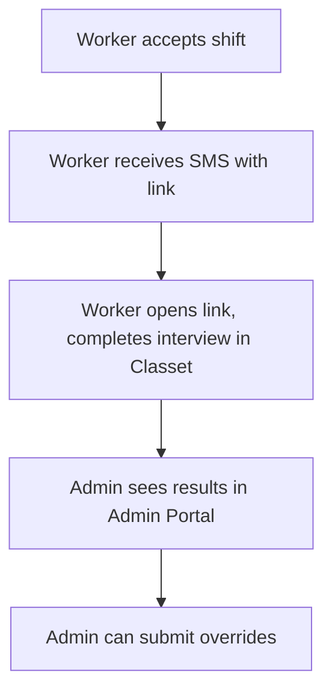
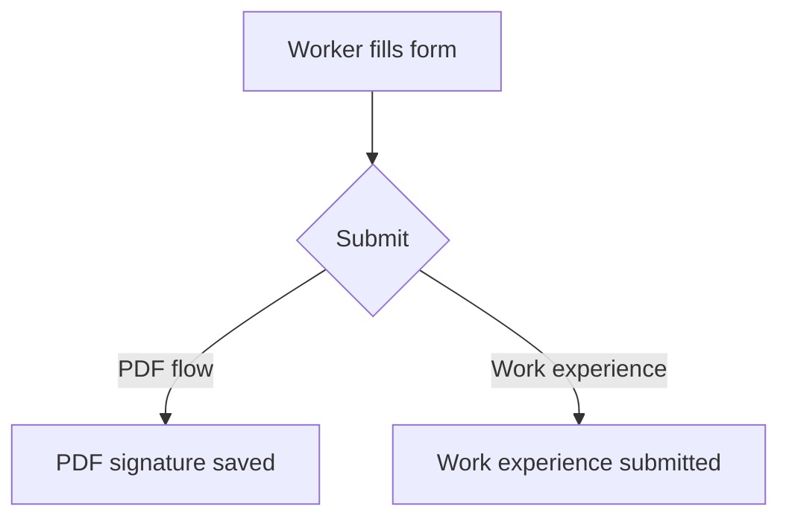
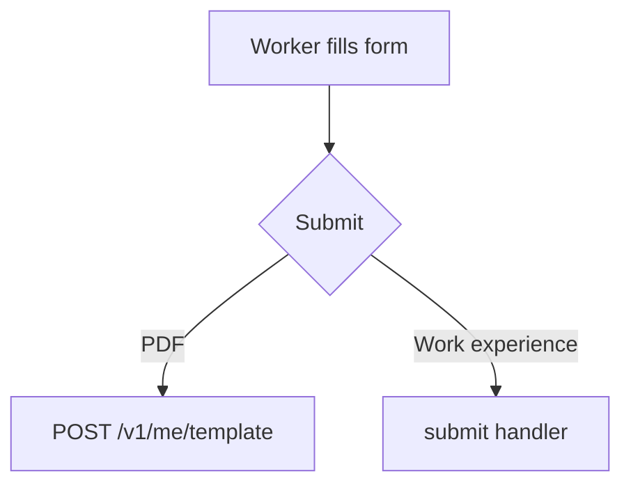
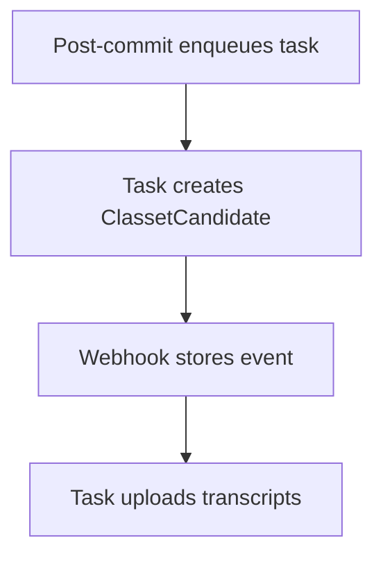

# Annotated Examples

Examples teach by demonstration. Use these to calibrate output quality.

---

## Leading sentences

Pyramid Principle: answer first. Lead with the conclusion or key message; support follows.

### In brief — good

> Product and backend teams define forms via JSON without writing new React components; SchemaRenderer renders them at runtime via a component registry and action mapping. FormSchema is the JSON structure that describes fields, components, and validation.

Value first; definition follows.

### In brief — bad

> FormSchema is a JSON structure that describes form fields, components, and validation. SchemaRenderer consumes a FormSchema and renders a React form. This enables product and backend teams to define forms without writing new React components.

Definition first; value at the end. Invert: lead with value.

### UX Context — good

> Employers rely on this flow to verify worker fit before shift start; workers complete interviews on their own time via SMS link, with no in-app experience.

Value, constraint, and user gain are clear. No step summary.

### UX Context — bad

> The flow runs outside the app: worker accepts shift → receives SMS → completes interview → webhook notifies backend → admin views and overrides.

Step summary. Belongs in the diagram.

### Code flow — good

> This flow enables pre-shift verification via external AI interview; implementation uses async tasks and webhooks, with admin override capability.

Impact and implementation approach. Not a step list.

### Code flow — bad

> Step 1: Worker accepts. Step 2: Task enqueues. Step 3: SMS sent. Step 4: Worker completes interview. Step 5: Webhook.

Step list. Belongs in the body.

---

## UX Context diagram

### Feature flow (correct)



User actions and outcomes only.

### Outcome branches (correct)



Outcome branches are user-facing results, not endpoint names.

### Outcome branches (wrong for UX Context)



Implementation details. Use "PDF signature saved" / "Work experience submitted" instead.

### Code flow (wrong for UX Context)



Implementation steps. Belong in Code flow.

---

## Terminology

### Good

- **Assessment** — A worker requirement verified via Classet AI voice interview; `WorkerRequirement.verification_type = assessment`.
- **ClassetCandidate** — A worker scheduled for or having completed a Classet interview; stores `interview_panel_url`, `webcall_url`, `status`.

Short, precise, includes technical anchor when useful.

### Bad

- **Assessment** — It's when we verify workers.
- **ClassetCandidate** — The candidate model in the database.

Vague. No technical anchor.

---

## Reference subsection

Each subsection adds new, specific detail not covered above.

### Good — Eligibility

> Positions are enabled via Statsig dynamic config `assessments_enabled_company_positions` [[3]](#ref-3). Config shape: `{ "company_position_ids": [int, ...] }`. `get_assessments_enabled_company_positions()` returns this; `is_position_enabled_for_assessments(company_position_id)` checks membership. If the config is missing or invalid, the backend falls back to `company_position_ids=[]` (no positions enabled). Manage via [Statsig console](https://...).

Config shape, function names, fallback behavior, management link.

### Good — Admin override

> POST `/v1/admin/user/<user_id>/assessments` [[9]](#ref-9) calls `submit_admin_user_assessments` [[2]](#ref-2). Validation order:
>
> 1. **Duplicate IDs** — `worker_requirement_ids` must be unique in the request.
> 2. **Requirement exists** — Each ID must exist with `verification_type=assessment`.
> 3. **Candidate exists** — `external_candidate_id` must match a `ClassetCandidate`.
>    ...

Validation order, error conditions, success behavior.

### Bad — repeats Code flow

> The admin can submit overrides via POST /v1/admin/user/assessments. This is described in Step 8.

No new detail. Repeats what Code flow already says.

---

## Advanced subsection

Adds new detail. Does not repeat Reference or Code flow.

### Good — Backfill cron

> `GET /v1/cron/assessments/backfill_shift_accept_notifications` [[2]](#ref-2) calls `handle_backfill_shift_accept_notifications`. Filter: `WorkerShiftAssoc.status=scheduled`, `WorkShift.starts_at > NOW()`, `WorkShift.cancelled_at IS NULL`, position has assessment requirements via `AssocCompanyPositionWorkerRequirement` + `AssocWorkerRequirementClassetJob`, and no `ClassetCandidate` for that worker+job. Enqueues one task per eligible WSA to `ASSESSMENTS_NOTIFICATIONS` (same queue as Step 2). Cron schedule is external (Cloud Scheduler or similar).

Filter criteria, queue, schedule note. All new.

### Good — Leveling

> `WorkerRequirementAssessmentLevel` [[10]](#ref-10) stores `(worker_requirement_id, position_template_id, level)` with `level` constrained 1–9; unique per requirement+template. `get_worker_requirement_assessment_levels(session, position_template_id, max_level=None)` [[2]](#ref-2) returns `list[_WorkerRequirementAssessmentLevelResponse]` (template name, requirement name, level). Optional `max_level` filters to `level <= max_level`. Used for worker profile / onboarding ordering; not used in the notify or webhook processing flow.

API signature, constraints, usage scope. Clarifies what it is not used for.

### Bad — repeats Reference

> Assessment requirements are linked to positions via AssocCompanyPositionWorkerRequirement. Each requirement links to ClassetJob via AssocWorkerRequirementClassetJob.

Already in Reference. No new detail.

---

## Troubleshooting case

### Good

```markdown
### Worker never got SMS

**Issue:** Worker accepted a shift but did not receive the assessment link.

**Fix:** Check that the position is in `assessments_enabled_company_positions` (Statsig). Verify `ClassetCandidate` exists for the worker and job; check `notified_at`. Inspect task logs for `assessments_notify_on_shift_accept` (task may have been skipped if position not enabled, worker not scheduled, or candidate already notified).

**Manual steps:** Run backfill cron if candidate was never created; ensure position is in Statsig config.
```

Issue, fix (with specific checks), manual steps. Actionable. Conditions in Issue/Fix must match code exactly (e.g. Loading appears when `getRegisteredFields` returns `null`, not when there are zero registered fields—`[]` is truthy and form renders).

### Bad

```markdown
### Worker never got SMS

**Issue:** Worker didn't get the link.

**Fix:** Check the config and logs.
```

Too vague. Not actionable.

---

## Data model — meaningful attributes

### Good

```
ClassetCandidate { int id PK, int worker_id FK, int classet_job_id FK, string external_candidate_id, string interview_panel_url, string webcall_url, string status, timestamp notified_at }
```

Includes attributes that convey meaning: `interview_panel_url`, `webcall_url`, `status`, `notified_at`.

### Bad

```
ClassetCandidate { int id PK, int worker_id FK, int classet_job_id FK }
```

Only PKs/FKs. No meaningful attributes.

---

## Citations

No blank lines between entries. Use explicit anchors so `[[N]](#ref-N)` links resolve.

### Good

```
<a id="ref-1"></a>**[1]** `backend/lib/shift/work.py` — Post-commit enqueue of `assessments/notify/shift_accept` when `WorkerShiftAssoc.status` becomes `scheduled`
<a id="ref-2"></a>**[2]** `backend/lib/assessments.py` — `handle_assessments_notify_on_shift_accept`, `handle_classet_interview_updated_event`, ...
```

### Bad

```
**[1]** `backend/lib/shift/work.py` — Post-commit enqueue

**[2]** `backend/lib/assessments.py` — ...
```

No anchor elements; blank line between entries.
